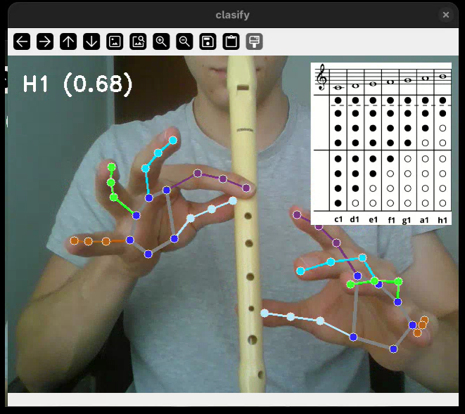

# Flauta

Flauta recognizes two-hand poses from a webcam and classifies them as notes. The project includes scripts for collecting samples, training a classifier, and running live recognition with an optional game mode.



## Technologies

- Python
- OpenCV (`opencv-python`) for webcam and image processing
- MediaPipe Tasks for hand and landmark detection
- NumPy for feature processing
- pandas and scikit-learn for data handling and Random Forest training
- Matplotlib and Seaborn for displaying the confusion matrix
- Joblib for saving and loading the trained model

## Requirements

- Python version supported by the installed MediaPipe release
- A webcam
- A graphical desktop environment for OpenCV windows

The required project assets are in `program/`: `hand_landmarker.task`, `notes.png`, `recorder_dataset.csv`, and `recorder_note_model.pkl`.

## Installation

From the project root, create and activate a virtual environment, then install the dependencies:

```bash
python3 -m venv .venv
source .venv/bin/activate
python -m pip install --upgrade pip
python -m pip install pandas scikit-learn matplotlib seaborn joblib numpy opencv-python mediapipe
```

## Running the project

The scripts use paths relative to their working directory. Run them from `program/`:

```bash
cd program
```

### 1. Capture samples

```bash
python capture.py
```

This opens the webcam and appends detected samples to `recorder_dataset.csv`. It collects the labels `c1`, `d1`, `e1`, `f1`, `g1`, `a1`, and `h1`. Both hands must be visible to record a sample. Existing CSV data is not cleared, so each run adds to it.

### 2. Train the model

```bash
python train_model.py
```

This trains a classifier using `recorder_dataset.csv`, prints accuracy and a classification report, displays a confusion matrix, and saves the model to `recorder_note_model.pkl`.

### 3. Run live recognition

```bash
python sandbox.py
```

This loads `recorder_note_model.pkl`, recognizes hand poses from the webcam, and starts in game mode with a randomly selected target. Keep both hands in view.

## Controls

- `q` - close the preview
- `l` - toggle hand landmark drawing
- `r` - toggle the reference image
- `g` - toggle game mode in `sandbox.py`

## Project files

- `program/capture.py` - webcam sample collection
- `program/train_model.py` - classifier training and evaluation
- `program/sandbox.py` - live recognition and game mode
- `program/shared.py` - shared configuration, landmark normalization, and helper functions
- `program/recorder_dataset.csv` - feature and label dataset
- `program/hand_landmarker.task` - MediaPipe hand detection model
- `program/recorder_note_model.pkl` - saved classifier
- `program/notes.png` - reference image shown in the preview